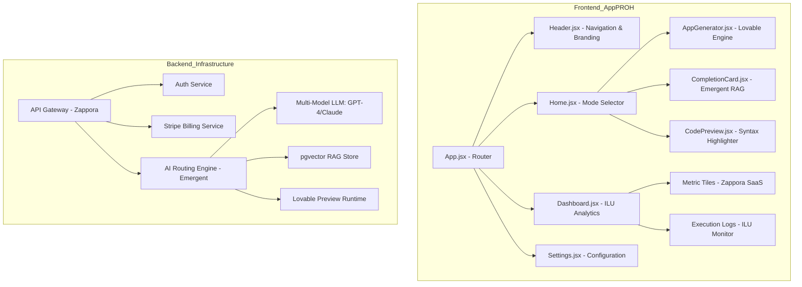

# AppPROH UI Architecture & Layout Summary

AppPROH is a unified AI platform frontend that combines the best architectural patterns and user experience elements from **Lovable.dev**, **Emergent.io**, and **Zappora**.

## 1. Core Platform Synergy

| Source | Feature Integrated into AppPROH | Component/Page |
| :--- | :--- | :--- |
| **Lovable.dev** | Instant Interactive Preview (<2s), Multi-step App Builder | `AppGenerator.jsx`, `Home.jsx` |
| **Emergent.io** | IDE-style Autocomplete, Context RAG Pipeline, Model Routing | `CompletionCard.jsx`, `Settings.jsx` |
| **Zappora** | SaaS Billing, Auth Workflows, ILU Metrics Framework | `Dashboard.jsx`, `Header.jsx`, `Settings.jsx` |

## 2. UI Architecture (Mermaid)

## 3. Page Structure

### Home Page (Unified Studio)
- **Top:** Hero section with unified branding.
- **Center:** 3-Mode Tab Switcher:
    - **App Builder:** Natural language prompt to full-stack app with live preview.
    - **Autocomplete:** IDE-style completion cards showing RAG context and model latency.
    - **Code Generation:** Focused code snippet generation with model selection.
- **Bottom:** Feature highlight grid (Lovable Preview, Emergent Autocomplete, Zappora SaaS).

### Dashboard (SaaS Metrics)
- **ILU Framework:** Real-time metrics for **I**nsights, **L**atency, and **U**sage.
- **Latency Stream:** Visual representation of p95/p99 latency across different pipelines.
- **Infra Health:** Real-time status of K8s clusters, vector databases, and code interpreters.
- **Execution Logs:** Detailed audit trail of platform events.

### Settings (Global Config)
- **AI Routing:** Toggle between GPT-4o, Claude 3.5 Sonnet, and Grok-2.
- **API Keys:** Secure management of platform secrets via Zappora workflows.
- **Subscription:** Tier management (Free/Pro/Enterprise) and billing status.

## 4. Visual Identity
- **Primary Gradient:** `#28a745` (Lovable) → `#6f42c1` (Emergent) → `#fd7e14` (Zappora).
- **Theme:** Slate-based dark mode (`slate-950`) with high-contrast accent colors for different services.
- **Typography:** Clean sans-serif for UI, monospaced for code and metrics.
